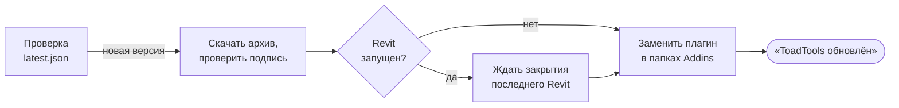

<p align="center">
  
</p>

<h1 align="center">ToadTools</h1>

<p align="center">
  Жаба в трее, которая ставит плагин <a href="https://github.com/Alexpivo394/ToadTools">ToadTools</a> для Autodesk Revit<br>
  и обновляет его, пока Revit закрыт.
</p>

<p align="center">
  <a href="https://github.com/Alexpivo394/ToadTools.Desktop/releases/latest"></a>
  <a href="https://github.com/Alexpivo394/ToadTools.Desktop/actions/workflows/Compile.yml"></a>
  <a href="LICENSE.md"></a>
</p>

<p align="center">
  <b><a href="https://github.com/Alexpivo394/ToadTools.Desktop/releases/latest">Скачать</a></b> ·
  <a href="https://github.com/Alexpivo394/ToadTools/wiki/Install">Инструкция</a> ·
  <a href="Changelog.md">Что нового</a>
</p>

---


Раньше обновление плагина выглядело так: скачать установщик, закрыть Revit, пройти установку — и так на каждом компьютере, с каждой новой версией.

Теперь этим занимается программа. Она замечает новую версию, скачивает её заранее и ставит, как только закрыт последний Revit. Работу она не прерывает и ничего не спрашивает.

## Установка

1. Скачайте `ToadTools-App-*.msi` со [страницы релизов](https://github.com/Alexpivo394/ToadTools.Desktop/releases/latest) и запустите. Права администратора не нужны: программа ставится для текущего пользователя.
2. В трее появится зелёная жаба. Она найдёт все Revit на компьютере, скачает плагин и разложит его по версиям.
3. Откройте Revit — на ленте будет вкладка **ToadTools**.

Старый ToadTools 4.0.x установщик уберёт сам.

Щелчок по значку открывает окно с версиями и настройками: как часто проверять обновления, в какие версии Revit ставить плагин, запускаться ли вместе с Windows, нужен ли прокси. Каждая настройка разобрана на странице [«Установка и обновление»](https://github.com/Alexpivo394/ToadTools/wiki/Install).

<br clear="right">

## Как это работает



**Проверка.** По расписанию (по умолчанию раз в 6 часов) программа читает `latest.json` из последних релизов двух репозиториев: [ToadTools](https://github.com/Alexpivo394/ToadTools/releases/latest) с плагином и этого, с ней самой. Файл берётся по постоянной ссылке `releases/latest/download/latest.json`. Это обычное скачивание, а не API GitHub, поэтому лимит в 60 запросов в час на адрес не мешает, даже когда весь офис сидит за одним роутером.

**Скачивание.** Архив плагина качается в папку `downloads`; после обрыва связи докачивается с того же места. Затем проверяется подпись, и архив распаковывается в `staging`.

**Ожидание.** Если Revit открыт, программа подписывается на завершение процессов `Revit.exe` и засыпает. Она ничего не опрашивает и не занимает процессор — о закрытии ей сообщает Windows.

**Замена.** Новая версия кладётся рядом в папку `ToadTools.new`, старая переименовывается в `ToadTools.old`, новая — в `ToadTools`. Если какой-то файл занят, всё возвращается как было, и программа попробует позже. Если компьютер выключили посередине, при следующем запуске она доделает начатое. Revit в любой момент видит либо старую версию целиком, либо новую — но не их смесь.

**Себя** программа обновляет тихой установкой MSI: закрывается, установщик меняет файлы и запускает её снова.

| Что | Где лежит |
|---|---|
| Программа | `%LocalAppData%\ToadTools\app` |
| Скачанное и распакованное | `%LocalAppData%\ToadTools\downloads`, `staging` |
| Журнал | `%LocalAppData%\ToadTools\logs` |
| Настройки | `%AppData%\ToadTools\settings.json` |
| Плагин | `%AppData%\Autodesk\Revit\Addins\{год}` |

## Подпись

Программа ставит только файлы, подписанные ключом проекта (ECDSA P-256). Если архив или MSI в релизе подменят, подпись не сойдётся и чужой код до пользователей не дойдёт.

Приватный ключ хранится в секрете GitHub `SIGNING_KEY`, один и тот же здесь и в ToadTools. Публичный зашит в программу: [`Security/PublicKey.cs`](source/ToadTools.Desktop.Core/Security/PublicKey.cs).

Новая пара генерируется командой `dotnet run --project build -- keygen <файл>`, но сменить ключ одним шагом нельзя: установленные программы знают только старый. Сначала выходит версия программы с новым публичным ключом, подписанная ещё старым, и только после неё релизы подписываются новым.

## Разработка

Нужны .NET 10 SDK и .NET Framework 4.8 Developer Pack. Сама программа собрана под .NET Framework 4.8: он есть в любой Windows 10 и 11, пользователю ничего доставлять не надо.

```powershell
dotnet run --project tests/ToadTools.Desktop.Tests -c Release   # тесты
cd build; dotnet run -c Release -- pack                          # MSI с подписью в папку output
```

| Папка | Что в ней |
|---|---|
| `source/ToadTools.Desktop.Core` | Вся логика без интерфейса: релизы, скачивание, подпись, замена плагина, ожидание Revit, настройки |
| `source/ToadTools.Desktop` | `ToadTools.exe`: значок в трее, уведомления, окно настроек на [ToadDesign](https://github.com/Alexpivo394/ToadDesign) |
| `tests/ToadTools.Desktop.Tests` | Тесты логики |
| `install` | Установщик MSI с окном в том же стиле |
| `build` | Сборка релиза |

Debug-сборку можно направить на свой сервер вместо GitHub: `--feed <адрес>` для релиза плагина, `--app-feed <адрес>` для релиза программы. Сама себя Debug-сборка не обновляет, иначе запуск из IDE ставил бы поверх релизный MSI.

Раскладка архива плагина — договорённость с репозиторием ToadTools: папки по годам, в каждой `ToadTools.addin` и папка `ToadTools`. Её проверяют тесты `PluginArchiveTests`; менять раскладку нужно сразу в обоих репозиториях.

### Выпуск версии

1. Допишите сверху [`Changelog.md`](Changelog.md) раздел `# X.Y.Z`.
2. Поставьте тег `X.Y.Z` или запустите **Actions → Publish release**.

GitHub соберёт MSI, подпишет и выложит релиз вместе с `latest.json`. Установленные программы подтянут его при следующей проверке. Номер версии программы с номером версии плагина не связан.

## Лицензия

[MIT](LICENSE.md)
